# SideKix — iOS demo

[](https://github.com/DavidMorenoEngineer/ios-demo/actions/workflows/ci.yml)
[](LICENSE)
[](https://developer.apple.com/swiftui/)
[](https://github.com/pointfreeco/swift-composable-architecture)
[](https://developer.apple.com/ios/)

A native iOS app that re-creates the **Advisors** section of the [SideKix](https://sidekixhq.com) website — a
searchable advisor list and a full advisor profile — built with **SwiftUI** and **The Composable Architecture**
(reducers and dependency clients). One codebase, laid out for **iPhone and iPad**.

It is the native counterpart to the [Flutter demo](https://github.com/DavidMorenoEngineer/flutter-demo): same
design tokens, same fictional advisors, a deliberately narrower scope, and the production-style stack.

> **Unofficial demo.** Built by [David Moreno](https://github.com/DavidMorenoEngineer) as a work sample. It is
> not affiliated with or endorsed by SideKix. Copy and design tokens are adapted from the public website; the
> advisors are fictional; there is no backend and no credentials.

## Advisors on iPhone

Cards with a quote and skills, offer filters, search — and a profile that pushes onto the stack.

| List | Filtered — Events | Scrolled under the bar | Search | Profile | Full screen |
|:----:|:-----------------:|:----------------------:|:------:|:-------:|:-----------:|
| 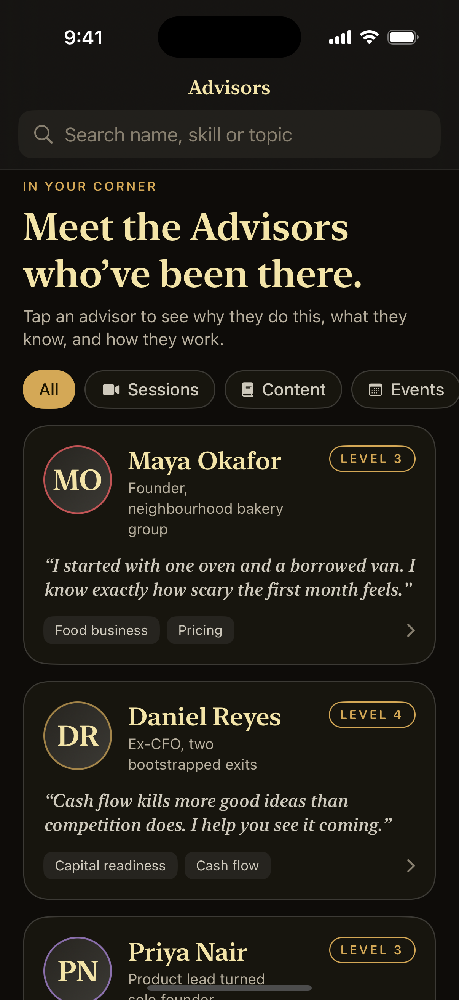 | 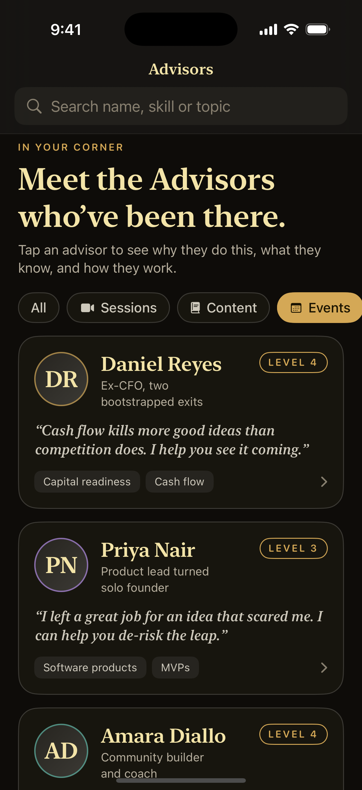 | 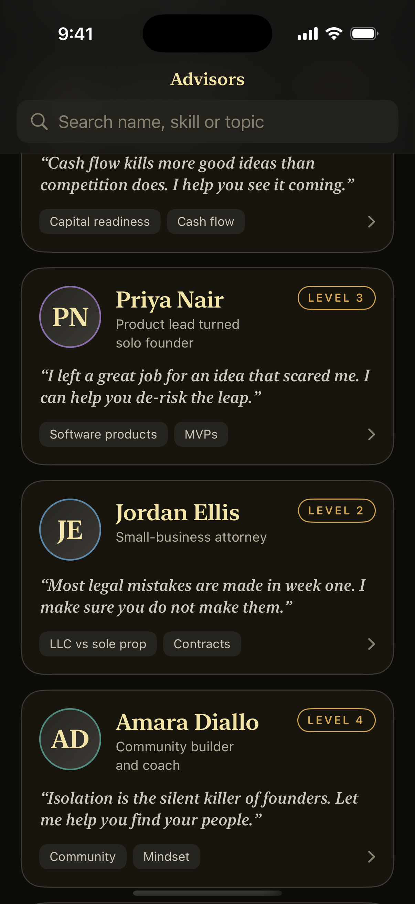 | 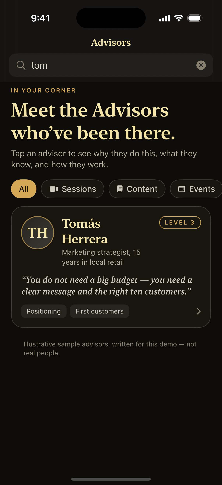 | 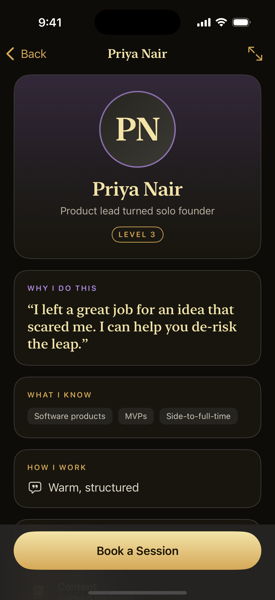 | 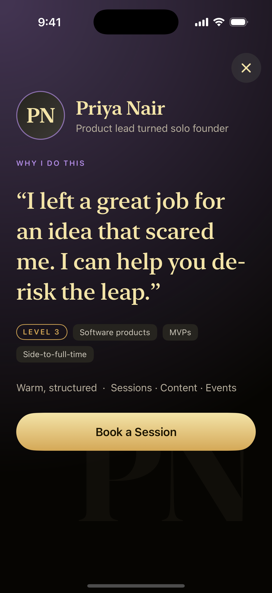 |

- **Search** matches name, title, skills and working style. **Offer chips** (Sessions · Content · Events)
  filter the list; "Clear filters" resets both.
- The top bar is a dark, slightly translucent band, so cards scroll underneath it and show through faintly.
- **Book a Session** asks the `BookingClient` and confirms with a toast that the reducer dismisses after three
  seconds.

## Advisors on iPad

The same screens, rearranged for the extra room.

| Portrait | Profile | Full screen |
|:--------:|:-------:|:-----------:|
| 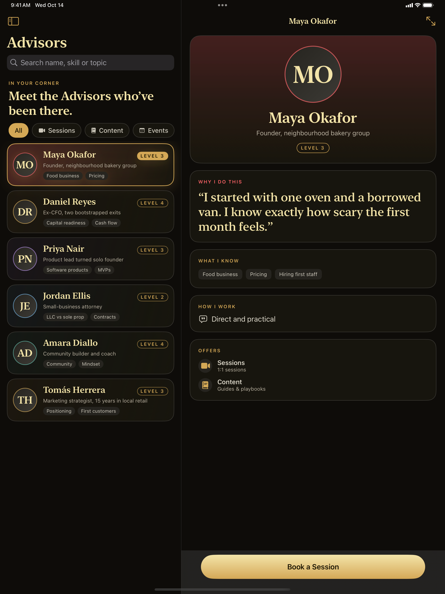 | 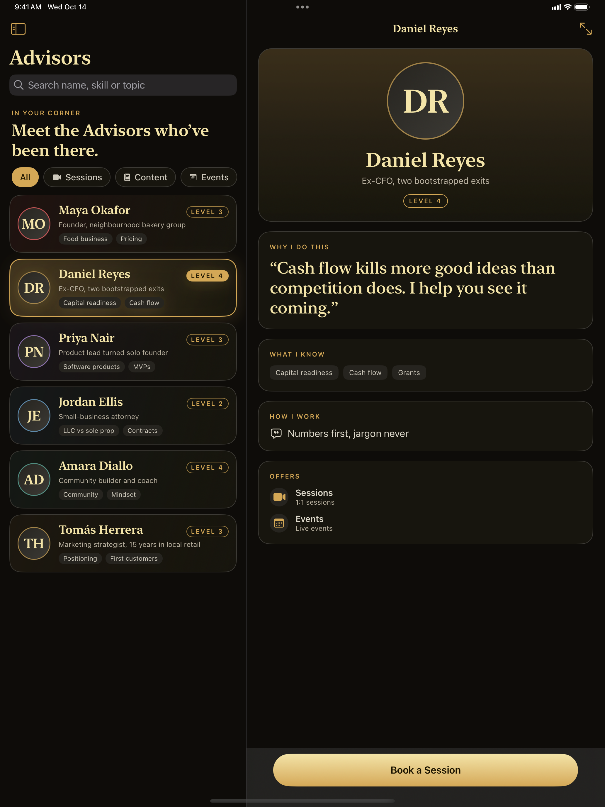 | 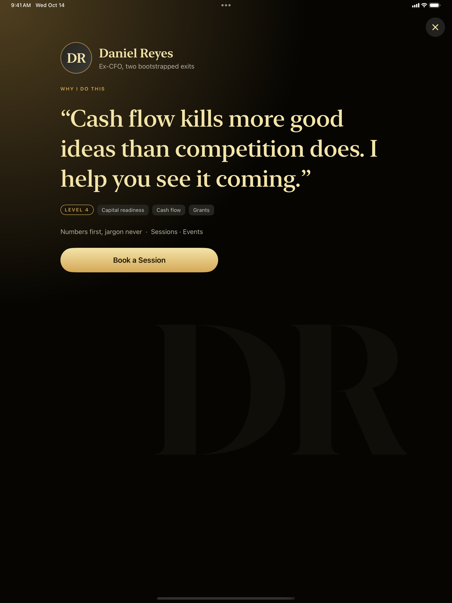 |

| Landscape — list and two-column profile | Landscape — full screen |
|:---------------------------------------:|:-----------------------:|
| 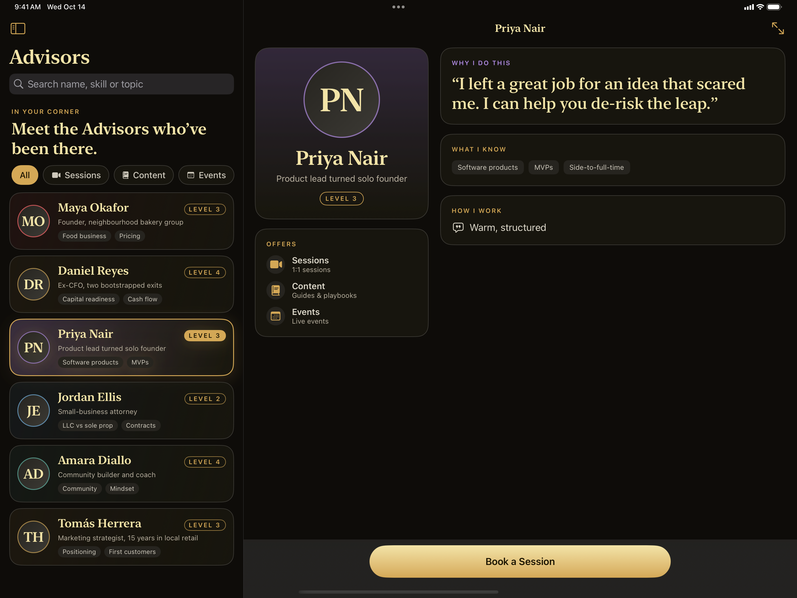 | 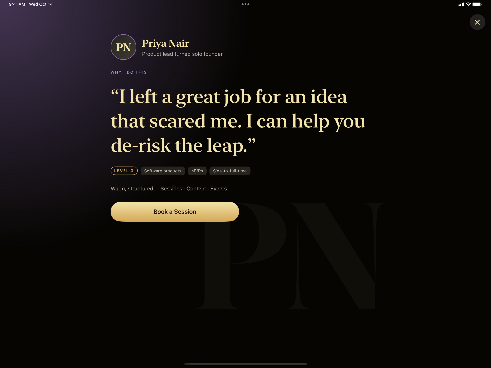 |

## Demo videos

A scripted tour of the advisor list and profile, one device at a time (click a preview for the full-quality MP4).

| iPhone (≈ 1 min) | iPad (≈ 1 min) |
|:----------------:|:--------------:|
| [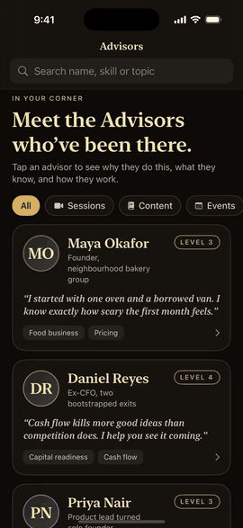](docs/videos/demo-phone.mp4) | [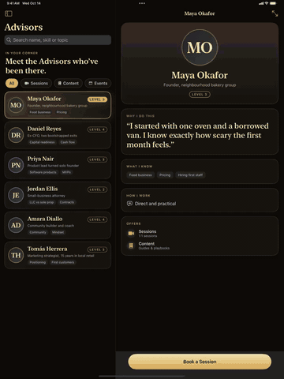](docs/videos/demo-pad.mp4) |

## Adaptive by design

Layout follows the space the view is given, not the device model, so it also holds up in iPad split-screen
and Slide Over.

| Where | Decided by | Result |
|-------|------------|--------|
| App shell | `horizontalSizeClass` | **Compact** → `NavigationStack` with the list as the root. **Regular** → `NavigationSplitView`: advisor list on the left, profile on the right |
| Profile | Measured content width (`onGeometryChange`) | **≥ 760 pt** → two columns (identity and offers beside the quote and skills). Narrower → one column |
| Skill tags | A custom `Layout` (`FlowLayout`) | Wraps onto new rows at any width |
| Full-screen profile | `horizontalSizeClass` | Larger type and margins on iPad; scrolls on small phones |
| Typography | Dynamic Type text styles | Serif display (New York) for headings, system body — scales with the user's text size (the full-screen quote uses fixed large sizes) |

The **full-screen profile** takes its cue from the website's one-idea-per-screen sections: a giant faded monogram,
the advisor's "why" set large, then skills, style and the booking button. Open it from the toolbar's expand icon.

## Architecture

The Composable Architecture: state, actions and a reducer per feature; side effects only through **dependency
clients**.

```
SideKixDemo/
├── App/             # SideKixDemoApp (store + title styling), DemoOptions (launch flags for screenshots)
├── Theme/           # SX design tokens (colours from the site), serif/body/label fonts
├── Domain/          # Advisor, Offer, Accent — plain Equatable/Sendable values
├── Clients/         # AdvisorsClient, BookingClient — all mock data lives here
├── Components/      # AvatarView, LevelBadge, TagChip, FlowLayout, SearchField, Toast, GoldButtonStyle
└── Features/Advisors/
    ├── AdvisorsFeature.swift     # list state: phase, query, filter, selection, StackState path, @Presents detail
    ├── ProfileFeature.swift      # one advisor: full-screen flag, booking, toast
    ├── AdvisorsView.swift        # size-class switch → stack (iPhone) or split view (iPad)
    ├── AdvisorProfileView.swift  # adaptive profile + the full-screen presentation
    └── AdvisorCard.swift         # phone card, iPad row, offer chips
```

- **Clients own the data.** `AdvisorsClient` and `BookingClient` are `@DependencyClient` structs. The mock
  advisors live in `AdvisorsClient.mockAdvisors`; `liveValue` is the mock with a realistic delay, `previewValue`
  is instant, and `testValue` is unimplemented, so a test fails unless it overrides the client. A real API client
  replaces `liveValue` and nothing else changes.
- **Reducers are pure.** Advisors are stored once; filtering is a derived property of state, so there is nothing
  to keep in sync.
- **Navigation is state.** The iPhone stack is driven by `StackState<ProfileFeature.State>` and the iPad detail
  pane by `@Presents`, each a real child `ProfileFeature` with its own booking and toast effects, cancelled when
  the profile is popped.
- **Loading, failure and empty states** are modelled (`Phase`), with a retry action and a "Clear filters" action.

## Tech stack

| Concern | Choice |
|---------|--------|
| UI | SwiftUI (iOS 17+), `NavigationSplitView`, a custom `Layout`, `onGeometryChange` width measurement |
| State | The Composable Architecture 1.17 — `@Reducer`, `@ObservableState`, `BindableAction` |
| Side effects | Dependency clients (`swift-dependencies`), `continuousClock` for the toast |
| Concurrency | `async`/`await`, `Sendable` values |
| Project | [XcodeGen](https://github.com/yonaskolb/XcodeGen) — `project.yml` is the source of truth |
| Tests | XCTest + `TestStore`, `TestClock` |

## Tests

```shell
xcodegen generate
xcodebuild test -project SideKixDemo.xcodeproj -scheme SideKixDemo \
  -destination 'platform=iOS Simulator,name=iPhone 16 Pro' \
  -skipMacroValidation -skipPackagePluginValidation
```

Tests run against the mock clients (the `SideKixDemoTests` target):

- **Loading** — the list is filled from `AdvisorsClient`, the first advisor is selected, a profile child is built
  for each advisor.
- **Failure and retry** — a throwing client shows the friendly message; "Try again" recovers.
- **Search and filter** — name, skill and style matching; no-match; the Events filter; clearing.
- **Navigation** — opening an advisor selects it and pushes it; an unknown id is ignored.
- **Booking** — the toast appears with the right message and is dismissed after three seconds on a `TestClock`; a
  failing client shows the fallback message.
- **Full screen** — expand and dismiss.

## Run it

Requires Xcode 16+ and [XcodeGen](https://github.com/yonaskolb/XcodeGen) (`brew install xcodegen`).

```shell
xcodegen generate
open SideKixDemo.xcodeproj      # run on an iPhone or iPad simulator
```

The app accepts launch arguments that put it in a specific state — this is how the screenshots are made:

| Argument | Effect |
|----------|--------|
| `-demoAdvisor a3` | Open an advisor's profile (`a1`–`a6`) |
| `-demoImmersive` | …and open the full-screen presentation |
| `-demoFilter events` | Apply an offer filter (`sessions`, `content`, `events`) |
| `-demoQuery tom` | Type a search |
| `-demoScrollTo a3` | Scroll a card up under the top bar |

(Debug builds only.)

```shell
xcrun simctl launch booted com.davidmorenoengineer.sidekixdemo -demoAdvisor a2 -demoImmersive
xcrun simctl io booted screenshot docs/screenshots/example.png
```

### Build notes

- **Debug dylib and package modules.** With Xcode 16, the app and test targets list TCA's lower-level modules
  (`Dependencies`, `CasePaths`, `IdentifiedCollections`, `Clocks`, `ConcurrencyExtras`, `CustomDump`,
  `Perception`, `IssueReporting`, `SwiftNavigation`, `OrderedCollections`) as direct
  dependencies in `project.yml`; without them the linker reports undefined symbols for modules TCA re-exports.
- **`swift-navigation` is pinned to 2.2.3.** SwiftPM otherwise resolves a release that needs a newer Swift than
  Xcode 16.2 ships.
- **`-skipMacroValidation`** is required on the command line because TCA ships Swift macros.
- If a build fails to link after changing packages, delete `DerivedBuild` / DerivedData and build again.

Demo code (launch arguments, scroll helper) is compiled only in Debug.

### Demo videos

`tool/record_demo.sh <udid> <phone|pad>` records a scripted tour (`SideKixDemoUITests`) on one simulator and
trims it with ffmpeg. It refuses to run if another simulator is booted.

## How the screenshots were made

All screenshots are native-resolution captures from the iPhone 16 Pro and iPad Pro 13" (M4) simulators, taken by
launching the app with the arguments above and calling `xcrun simctl io <device> screenshot`. The iPad landscape
shots rotate the simulator with *Device ▸ Rotate Right* and turn the framebuffer capture upright with `sips`.
The status bar is overridden to 9:41 with `xcrun simctl status_bar`. One simulator is booted at a time.

## License

MIT — see [LICENSE](LICENSE).
